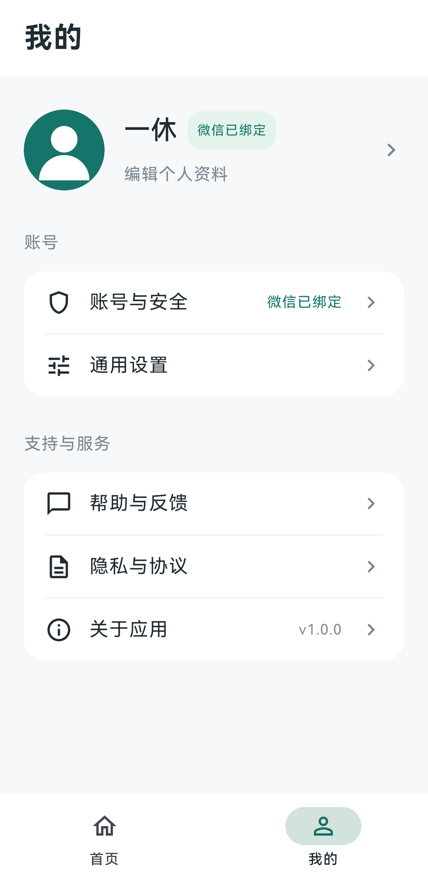

# 个人中心

2026-10-29：工具类 App 的紧凑资料头部与分组列表，支持跟随系统、浅色、深色主题；配色使用语义颜色。使用原生 Compose / Material Icons，不新增后端功能。下图为此前浅色界面的虚拟账号截图，当前验证见[基础工程验收](verification-2026-10-29-toolkit-foundation.md)。

## 页面入口

| 页面 | 内容 |
| --- | --- |
| 我的 | 当前头像、昵称、绑定状态；账号与安全、通用设置、帮助与反馈、隐私与协议、关于应用 |
| 点击顶部资料区 | 正式账号打开昵称/默认头像编辑；游客进入账号与安全登录。游客仍可在账号与安全编辑资料 |
| 账号与安全 | 账号 ID、绑定状态、未绑定身份的登录/绑定入口、更新账号信息、当前设备退出、验证注销 |
| 通用设置 | 系统/浅色/深色主题；仅清理工具临时缓存；支持邮箱、反馈、市场版本链接及备案；更新账号信息；debug 开关联调工具时显示开发工具 |
| 帮助与反馈 | 本地账号常见问题；与设置页共用反馈入口，HTTPS 网页优先、支持邮箱兜底 |
| 隐私与协议 | 数据使用说明、政策/协议、SDK 与权限说明、系统权限设置；确认后可撤回同意，保留账号凭证并暂停服务 |
| 关于应用 | product.properties 的应用名、实际构建版本号 |

二级页面使用左上返回或系统返回回到“我的”，首页/我的双标签只在一级页面显示。资料头部长昵称省略显示，编辑框仍可编辑完整昵称；内容可纵向滚动。

## 配置

通用按钮、表单、状态与结果提示集中在 `app/src/main/res/values/strings.xml`；产品帮助、隐私说明、引导及示例文字集中在 `product_strings.xml`。产品名、环境、链接和开关仍来自原 properties，协议值与持久化字段不当作文案翻译。

## 资料保存与基础适配

- 点击保存保留编辑器和草稿，等待明确成功后关闭。明确失败就地显示原因并允许重试；用户仍可主动取消。
- 结果未知时锁定输入和保存，使用“继续确认保存”恢复原请求，不生成重复写入。资料保存因过期令牌转入 refresh 时沿原续接恢复；其他会话待确认操作显示“处理账号状态”，恢复后仍保留未提交草稿。
- 昵称、头像选择与编辑器开关支持保存状态恢复；按账号/环境隔离。普通取消后不保存草稿；系统不提供保存状态的强制结束不保证恢复未提交输入。已发出的请求恢复仍由原加密 Vault 管理。
- 页面最大宽度 640dp、居中显示，窄屏收紧留白；资料标题和状态上下排列。弹窗随实际窗口限高，正文可滚动，按钮保持可达；头像自动换行。保留系统字号，不新增平板专属页面。

当前证据与验证范围见[资料保存与适配验收](verification-2026-10-29-profile-adaptive-copy.md)。

公开信息放在构建对应的 `environments/test.properties` 或 `environments/production.properties`。三个公开 HTTPS 地址为：`FEEDBACK_URL`、`PRIVACY_POLICY_URL`、`TERMS_URL`。测试空值保留未配置提示；正式发布检查会阻止缺失或不符合规则的政策/协议地址。当前测试政策/协议地址留空，并明确标记为测试说明；正式政策、协议、主体和支持邮箱必须补齐，缺项会阻止正式打包。复制时填写属于该产品的信息，重新构建后生效。

这些不是 API，也不携带登录凭证。仍通过系统浏览器打开，不嵌入 WebView，不引入新的后端接口。

## 启动与设置边界

首次安装、旧版无同意记录及隐私版本变化时，先展示说明。同意前不创建账号 ViewModel、不开始账号网络请求或微信 SDK；拒绝可继续本地工具及普通设置。撤回在无进行中、待确认请求及微信回调时才允许，操作不等于退出或注销，也不删除原凭证。

主题保存在独立 app-settings 偏好中。普通“清理临时缓存”只处理 cacheDir/tool-temp，不影响 Vault、偏好或用户文件，与开发工具的“全部本地数据清除”不同。引导默认关闭，开启后按独立版本记录完成或跳过。

## 原有账号行为

- 工具首页不展示账号加载或恢复卡片，自动连接成功/失败不弹吐司；失败信息在账号页保留。进入“我的 → 账号与安全 → 处理账号状态”后，用弹窗继续同一次操作；稍后处理不会清除凭证或恢复材料。
- 普通操作结果用一次性 Toast，消费后不因旋转或回前台重放；需要选择/确认的操作用弹窗。输入格式或验证码无效就地提示，页面加载失败提供重试；发送、验证、连接等按钮显示执行状态并防重复点击。
- 正式版隐藏未启用的登录方式；debug 保留禁用的待配置入口用于诊断。已绑定身份仍展示绑定状态，注销验证规则不变。
- 手机号支持粘贴 `+86 138-0013-8000` 等常见格式，其他国家前缀或非法字符仍报错。手机号草稿和表单步骤可随 Activity 重建恢复，验证码不持久化；切换账号/环境时不复用旧草稿。
- 微信头像/昵称仅在正常微信登录或绑定后提供一次可跳过的选择。编辑页不提供独立微信授权入口。
- 退出、注销仍须用户确认；新增隐私门禁和页面拆分不会自动退出、注销、重置或迁移账号数据。
- AccountEngine、Vault 格式、数据库和 Redis 配置均保持不变。日常升级使用 `adb install -r` 保留数据；设备测试必须保留 APK，参见下文。

实现：`ui/ProfileCenter.kt` 为页面与分组组件，`ui/StarterScreen.kt` 维护导航和设置/隐私插槽，`ui/account/` 维护账号页面、表单、确认弹窗及恢复状态；`UiStates.kt` 提供公共加载/空态/错误展示。预设头像沿用已有组件，不替换用户的微信头像或昵称。

`ui/Feedback.kt` 统一结果 Toast 和反馈入口。`FEEDBACK_URL` 可用时打开网页，否则使用 `SUPPORT_EMAIL`；无法打开外部应用时，已配置邮箱可在弹窗复制。两项都为空时正式版不显示入口，debug 显示配置说明。网页/邮箱不自动附带账号和日志。

新产品业务首页只在 `ui/ProductHome.kt` 接入；正常模式和本地模式均调用它，本地模式不能提前初始化账号或微信。文本计数仅为占位，本轮不增加历史记录、分享或撤销等能力。当前改动和验证见[交互整理验收](verification-2026-10-29-tool-ui-refinement.md)。

## 真机测试注意事项与历史事件

此前个人中心阶段首批 `connectedDebugAndroidTest` 使用 AGP 默认收尾行为，测试结束自动卸载了主应用，造成 P30 本地登录状态丢失；重新安装启动自动进入游客 13。未执行服务端账号重置、注销或退出，原绑定账号需要通过原登录方式重新进入。没有自动替用户登录或重置账号。

已在 `gradle.properties` 固定 `android.injected.androidTest.leaveApksInstalledAfterRun=true`。本机 AGP 9.4.1 的 BooleanOption 已核对支持该选项，默认原为 false；修正后再次运行隔离 UI 测试，首次安装时间及 `no_backup/account-vault` 的加密文件摘要均不变。只运行 `StarterUiTest`，不在用户日常手机运行全量存储/清理类测试。该配置只能防止测试后的自动卸载，不能阻止显式清除数据的测试代码。

官方相关记录：[AGP 仪器测试卸载行为](https://issuetracker.google.com/issues/295039976)。
